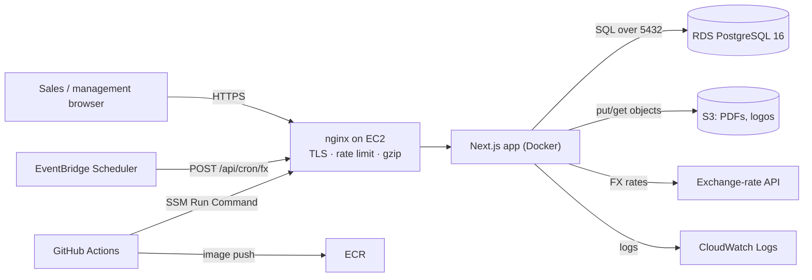
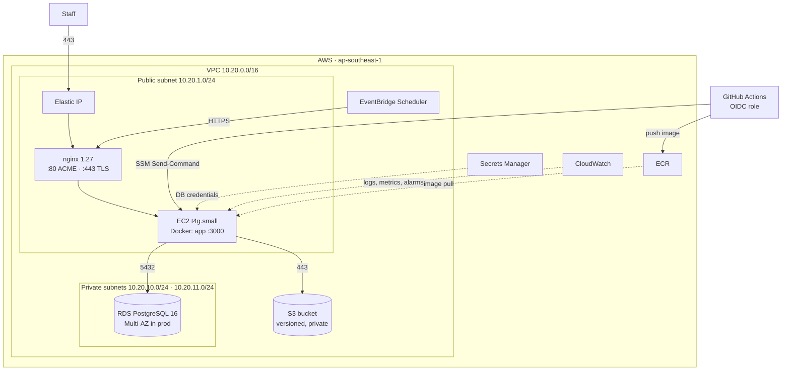
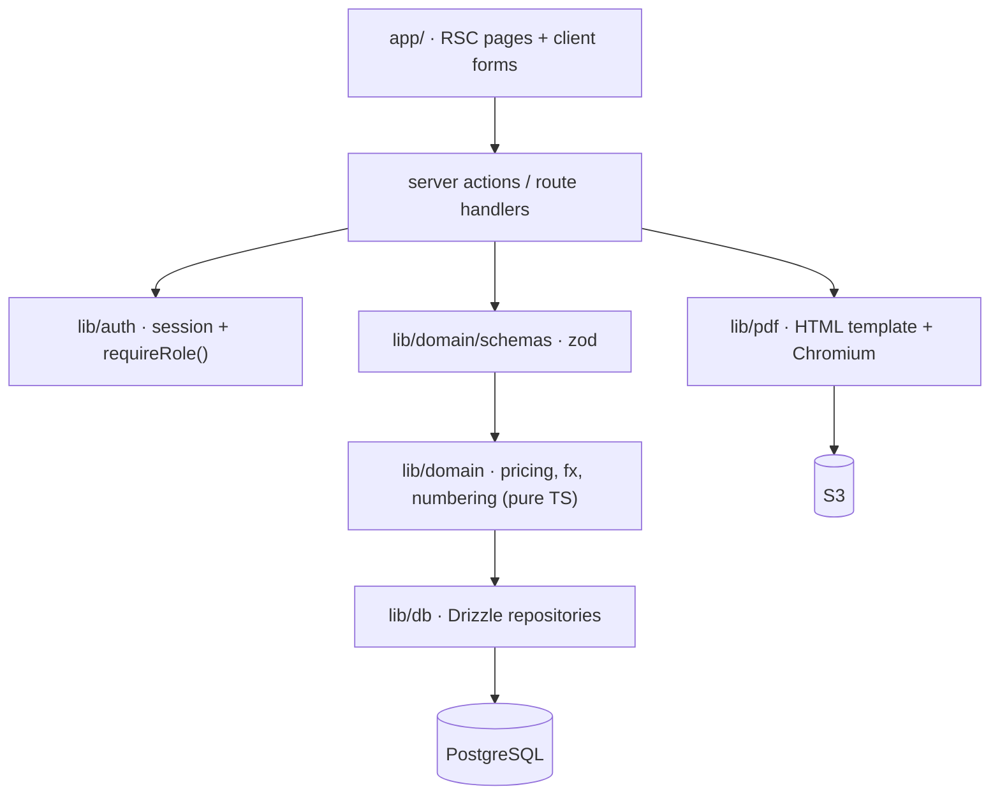
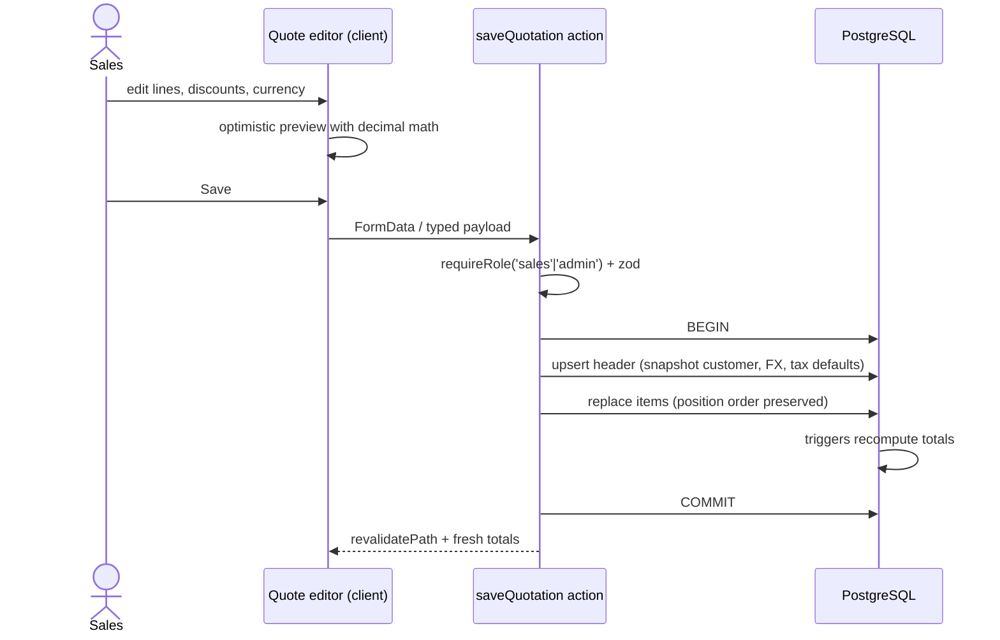
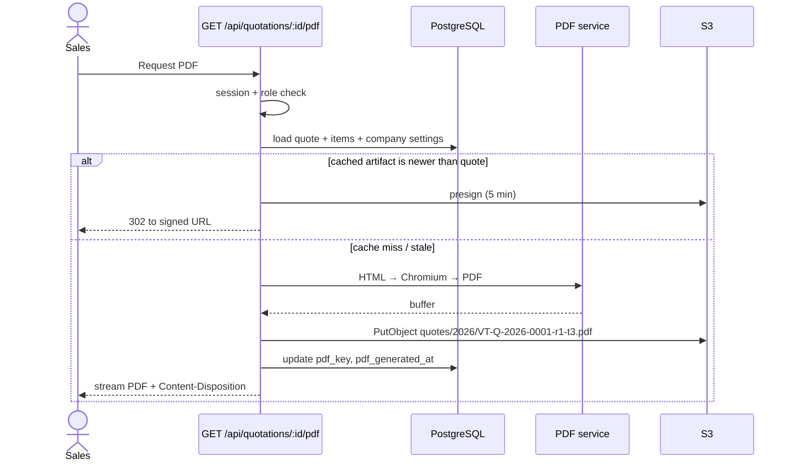

# 01 — System Architecture

## 1. Purpose and scope

QGS replaces the current spreadsheet + Word-template workflow for preparing
quotations. It is used by VitalTech Myanmar staff only (sales, engineering,
management), not by customers.

**In scope (MVP)**

- Maintain a catalog of products/services with cost and multi-currency sell prices.
- Build a quotation from catalog items or free-text lines, with line and header discounts.
- Branded PDF (A4) with Myanmar/English text, bank details, terms, signature block.
- Multi-currency: quote in MMK, USD, or THB with a stored FX snapshot.
- Quotation lifecycle: draft → sent → accepted / rejected / expired, with revisions.
- Reporting: quoted value, win rate, pipeline, product performance, margin.

**Out of scope (MVP)**

- Customer self-service portal, e-signature, payment collection.
- Full approval workflow (guaranteed by a later phase; MVP uses margin warnings).
- Accounting/ERP integration, inventory.
- Email delivery from the app (PDF is downloaded and sent manually at first).

**Assumptions**

| Item | Assumption |
|---|---|
| Users | 10–25 staff accounts, 5–10 concurrent |
| Volume | 50–150 quotations/month, ~30 line items max each |
| Availability | Business hours, 99% is acceptable |
| Data residency | AWS `ap-southeast-1` (no Myanmar region exists) |
| Locale | `Asia/Yangon` (UTC+6:30), MMK base currency |
| Input script | Unicode Burmese (Zawgyi rejected with a warning) |

## 2. System context

Everything is server-rendered; the browser never talks to the database directly
and never holds AWS credentials.

## 3. Deployment topology

nginx is the default edge: it terminates TLS with Let's Encrypt certificates,
serves the ACME challenge, enforces per-IP login throttling, and proxies to the
app over the Docker network. Certbot runs on the host with a systemd timer (see
[doc 06](06-security-and-aws-ops.md#6-tls-certificates)).

**High-availability form (optional):** put an ALB + ACM certificate in front,
switch nginx to HTTP-only behind `sg-alb`, and run the app in an Auto Scaling
Group (min 1, max 2). Roughly +USD 20/mo, removes the single-instance failure
point, and requires no application change.

**No edge at all (not recommended):** exposing the Next.js container directly
loses the login throttle, header hardening, and clean certificate reload.

**Instance sizing:** `t4g.small` (2 vCPU, 2 GB) + 2 GB swap. Chromium under
concurrency 2 peaks around 600 MB. `t4g.medium` is the next step if PDF preview
traffic grows.

## 4. Application layers

Dependency rule: `app → domain → db`. The domain layer is pure TypeScript with no
Next.js or database imports, so pricing rules can be unit-tested in milliseconds.
SQL triggers are the final authority on stored totals.

## 5. Key decisions

| # | Decision | Alternatives rejected | Why |
|---|---|---|---|
| D1 | Next.js monolith with server actions | Separate Express/Nest API + SPA | One deployable, one auth boundary, faster iteration for a 1–2 dev team |
| D2 | EC2 + Docker (not Lambda/Amplify) | Lambda, App Runner, ECS Fargate | Chromium bundle and memory, no 15-min limit, simple local parity, fixed cost |
| D3 | RDS PostgreSQL 16 | Aurora Serverless v2, MySQL | Standard Postgres features (generated columns, triggers, `numeric`), predictable cost, easy restore |
| D4 | Drizzle ORM + SQL migrations | Prisma, raw SQL | Thin runtime, typed schema, `numeric` handled as strings, migrations are plain SQL and reviewable |
| D5 | Auth.js v5 credentials, Argon2id, JWT | Cognito, hand-rolled sessions, SSO | 10–25 internal accounts, no external IdP; Cognito adds setup and UI work with no benefit yet |
| D6 | Chromium HTML→PDF | `@react-pdf/renderer`, wkhtmltopdf, DocRaptor | Correct Myanmar shaping, full CSS, page headers/footers; vendor-free |
| D7 | S3 for generated PDFs | EBS volume, DB bytea | Stateless containers, presigned downloads, versioning, cheap |
| D8 | Database triggers recalculate totals | App-only calculation | Guarantees no path (import, manual SQL, API bug) can persist inconsistent totals |
| D9 | App-layer RBAC | Postgres RLS | Single trusted server process; RLS complicates pooling and background jobs. Revisit if a second client appears |
| D10 | Forward-only SQL migrations | Auto-sync (`drizzle push`) in prod | Auditable, reversible by backup, safe deploy ordering |
| D11 | nginx terminates TLS on the instance | ALB + ACM, Caddy, Traefik | Team already runs nginx; full control of headers, rate limits and timeouts; no extra managed service. ALB remains a drop-in upgrade for HA |
| D12 | Let's Encrypt via host certbot + systemd timer | certbot container, ACM | Certificates and renewal survive container restarts; reload hook drops into the same compose stack; no third-party image |

## 6. Runtime views

| Process | Where | Responsibility |
|---|---|---|
| Next.js server | EC2 container, port 3000 | Pages, server actions, PDF route |
| Chromium | Child process of the app | Renders one quote at a time (semaphore = 2) |
| FX sync | `POST /api/cron/fx`, daily 09:00 Yangon | Pull rates, store history, never overwrite past snapshots |
| Expiry sweep | `POST /api/cron/expire`, daily | Mark `sent` quotes past `valid_until` as `expired` |
| Migrations | One-off container on deploy | Apply `db/migrations/*.sql` before new app starts |

## 7. Request flows

### Create / edit a quotation

### Generate PDF

## 8. Non-functional targets

| Attribute | Target |
|---|---|
| Quote list / detail load | p95 < 800 ms server time |
| Save quotation (30 lines) | p95 < 500 ms |
| PDF generation (cold) | < 6 s; warm < 3 s |
| Concurrent editors | 5 without contention (per-quote locking) |
| Availability | 99% business hours; single-AZ app acceptable |
| RPO / RTO | 5 min / 2 h (RDS PITR + redeploy) |
| Backup retention | 14 days automated + monthly manual snapshot |
| Audit | Every status change, revision, and PDF regeneration recorded |

## 9. Capacity and growth

At 150 quotes/month and 30 lines each, the database stays under 10 MB/year of
quotation data — no partitioning or read replicas needed. The first real limits
are PDF memory and Chromium startup, not the database. When concurrent PDF use
grows, split rendering into a small worker queue (SQS + a second container) without
changing the schema.

## 10. Evolution path

1. **MVP** — single EC2, Docker Compose, manual `sent` tracking.
2. **Scale/HA** — ALB + Auto Scaling Group (min 1, max 2), RDS Multi-AZ, Redis for
   PDF job queue and FX cache.
3. **Workflow** — approval rules (discount/margin thresholds), email delivery with
   tracking, e-signature.
4. **Platform** — customer portal link per quote, ERP/accounting sync, SSO if the
   company adopts Microsoft 365 or Google Workspace.
