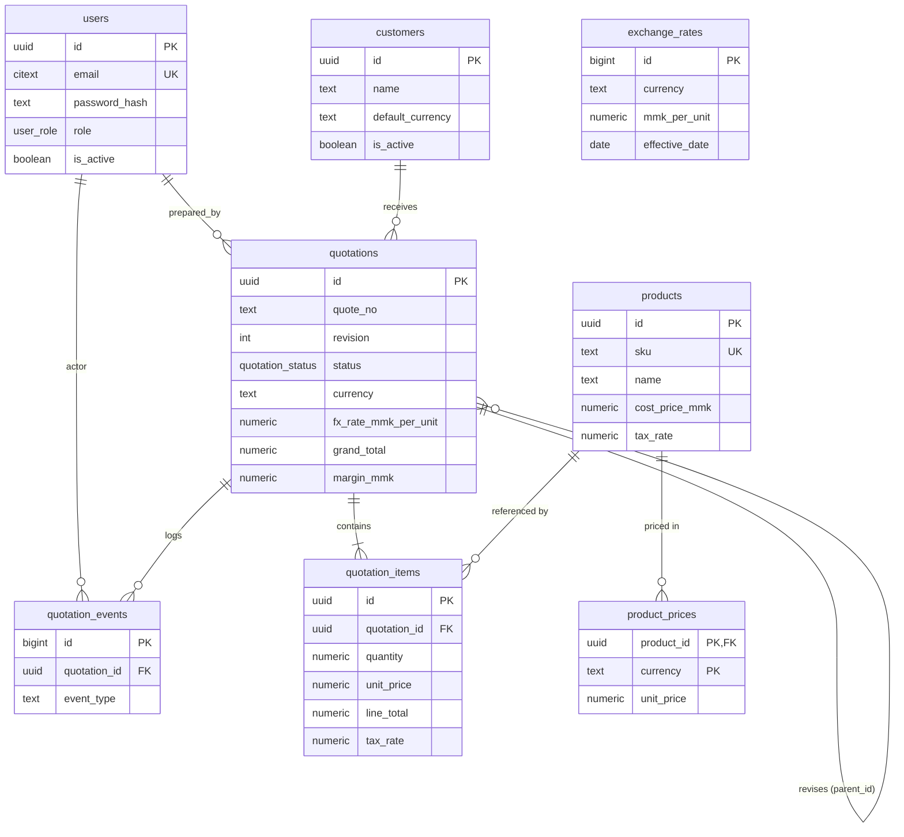
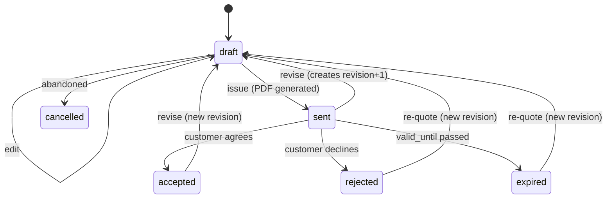

# 02 — Data Model

## 1. Entity relationship diagram

## 2. Design principles

1. **Snapshot at issue, reference for browse.** A quotation keeps its own copy of
   the customer block, product name/SKU/description, unit price, tax rate, FX rate,
   and terms. Foreign keys remain for filtering and reporting, but the PDF is built
   only from snapshots.
2. **Totals are derived, never typed.** `subtotal`, `discount_total`, `vat_total`,
   `grand_total`, MMK equivalents, cost, and margin are written by
   `recalc_quotation_totals()`, which fires from triggers on header and items.
3. **Money is `numeric`, not floating point.** `numeric(18,2)` for amounts,
   `numeric(18,4)` for unit prices (sub-cent pricing on imported equipment),
   `numeric(20,8)` for FX.
4. **Revisions are new rows, not in-place edits.** Once a quote is `sent`, edits
   create `revision + 1` linked via `parent_id`. History stays printable.
5. **Soft state, hard delete.** Customers/products are deactivated (`is_active`),
   never deleted while referenced. Draft quotations can be hard-deleted by admins.

## 3. Tables

### `users`

Internal staff only. There is no public sign-up route; admins create accounts and
the first login forces a password change.

| Column | Notes |
|---|---|
| `email` | `citext`, unique, lower-cased automatically |
| `password_hash` | Argon2id, never selected by app queries except at login |
| `role` | `admin` (all), `sales` (create/edit/send), `viewer` (read + PDF) |
| `is_active` | Disabling blocks login without deleting history |
| `must_change_password` | Set on invite and on admin reset |

### `company_settings` (single row)

Drives the PDF letterhead: legal name, brand name, registration/tax IDs, address,
phone/email/website, S3 logo key, bank details, default currency, default VAT rate,
default validity days, default payment/delivery/warranty terms, footer note. One row
enforced by `check (id = 1)`.

### `customers`

Billing block used on quotes: name, attention, tax ID, address, city, country
(default Myanmar), phone, email, preferred currency, notes, active flag.
`lower(name)` index for type-ahead search.

### `products` and `product_prices`

- `products` holds identity, unit, description, category, **cost in MMK**, default
  tax rate, and active flag.
- `product_prices` holds one row per sell currency (`MMK`, `USD`, `THB`). A quote
  line in USD should come from the USD price row; if missing, the UI shows the MMK
  price converted at the current FX rate and marks it "converted".
- Cost is always MMK so margin is comparable across currencies.
- Items never hard-link to prices: the chosen price is copied to the quote line.

### `exchange_rates`

History of `1 unit of foreign currency = N MMK`, keyed by `(currency, effective_date)`.
`source` is `manual`, `cbm` (Central Bank of Myanmar reference), or a provider name.

- Lookup for a quote date: newest row where `effective_date <= quote date`.
- If no rate exists for the selected currency, saving a foreign-currency quote is
  blocked with an actionable error ("enter today's USD rate in Settings").
- Past rates are immutable; corrections insert a new row with a note.

### `quotations`

Header plus totals. Notable columns:

| Column | Purpose |
|---|---|
| `quote_no` + `revision` | Unique pair. `VT-Q-2026-0001` Rev 1, 2, … |
| `parent_id` | Root quote of a revision chain (null on Rev 1) |
| `customer_id` + `customer_snapshot` | FK for reporting; JSONB copy for the PDF |
| `currency`, `fx_rate_mmk_per_unit`, `fx_rate_date` | FX frozen at save time |
| `default_tax_rate` | Default applied to new lines; lines store their own rate |
| `discount_kind`, `discount_value` | Header-level `none`, `percent` (0–100), `amount` (quote currency) |
| `subtotal`, `discount_total`, `vat_total`, `grand_total` | Quote currency |
| `subtotal_mmk`, `grand_total_mmk`, `cost_total_mmk`, `margin_mmk` | Reporting currency |
| `valid_until` | Date-only; drives expiry sweep and PDF validity text |
| `status` | `draft`, `sent`, `accepted`, `rejected`, `expired`, `cancelled` |
| `pdf_key`, `pdf_generated_at` | S3 object key and freshness marker |
| `prepared_by` | Salesperson shown on the PDF |

`margin_mmk` is a stored generated column:
`round((subtotal - discount_total) * fx_rate, 2) - cost_total_mmk`.

### `quotation_items`

| Column | Notes |
|---|---|
| `position` | Display order (0-based), preserved on save |
| `product_id` | Nullable; `SET NULL` on product delete. Snapshot keeps the line valid |
| `sku`, `name`, `description`, `unit` | Snapshots; editable per line |
| `quantity` | `numeric(14,3)` — supports 0.5 days, 2.75 m cable |
| `unit_price` | Quote currency, 4 decimals |
| `discount_pct` | 0–100, line level |
| `tax_rate` | 0–1 snapshot (e.g. `0.05`) |
| `line_total` | Generated: `round(qty * unit_price * (1 - discount_pct/100), 2)` |
| `cost_unit_mmk`, `cost_total_mmk` | Cost snapshot for margin, always MMK |

### `quotation_events`

Append-only log: `created`, `updated`, `pdf_generated`, `sent`, `accepted`,
`rejected`, `revised`, `expired`, `note_added`. Stores `actor_id` and a small JSONB
payload (changed fields, old/new status, template version). Use it for the activity
timeline on the quote page and for audit questions.

### `doc_counters`

One row per `(doc_type, period)`; `next_doc_no()` increments atomically with
`INSERT … ON CONFLICT DO UPDATE … RETURNING`. This is what makes numbering safe
under concurrency without `MAX(quote_no)+1` races.

## 4. Schema-level invariants

| Invariant | Enforcement |
|---|---|
| MMK quotes have FX = 1 | `check (currency <> 'MMK' or fx_rate_mmk_per_unit = 1)` |
| Revision ≥ 1 | `check (revision >= 1)` |
| Percent discount 0–100 | `check` on header and line |
| Tax rate 0–1 | `check` |
| Quantities positive | `check (quantity > 0)` |
| Totals never negative | `check` on totals |
| Unique quote number per revision | `unique (quote_no, revision)` |
| One price per product/currency | primary key `(product_id, currency)` |
| One rate per currency/day | `unique (currency, effective_date)` |

## 5. Quotation lifecycle

Rules:

- Only `draft` is freely editable. Editing a `sent`/`accepted`/`rejected` quote
  offers "Create revision", which copies the header and items into a new row.
- `accepted_at` / `sent_at` are set on transition, not editable by hand.
- `expired` is set by the daily sweep; opening an expired quote offers "Re-quote".
- Deleting is allowed only for `draft` and only for admins.

## 6. Retention and archival

- Quotations, revisions, and events are kept indefinitely (small data, high value).
- PDFs are retained in S3 with versioning; old revisions keep their own object key.
- S3 lifecycle: transition to Intelligent-Tiering after 90 days; never auto-delete.
- Customer/product rows are deactivated, not deleted.
- `quotation_events` older than 3 years can be archived if volume ever matters.

## 7. Migration conventions

- Files: `db/migrations/0001_init.sql`, `0002_*.sql`, forward-only, one logical change each.
- Every migration is applied inside a transaction; no `CONCURRENTLY` in the same file
  as other DDL (index builds use a separate migration with `-- drizzle:transaction off`).
- Destructive changes (drop/rename) require a backup snapshot and a two-step deploy
  (add new → backfill → switch reads → drop old).
- Local and staging databases are rebuilt from migrations; production is never
  hand-edited.
