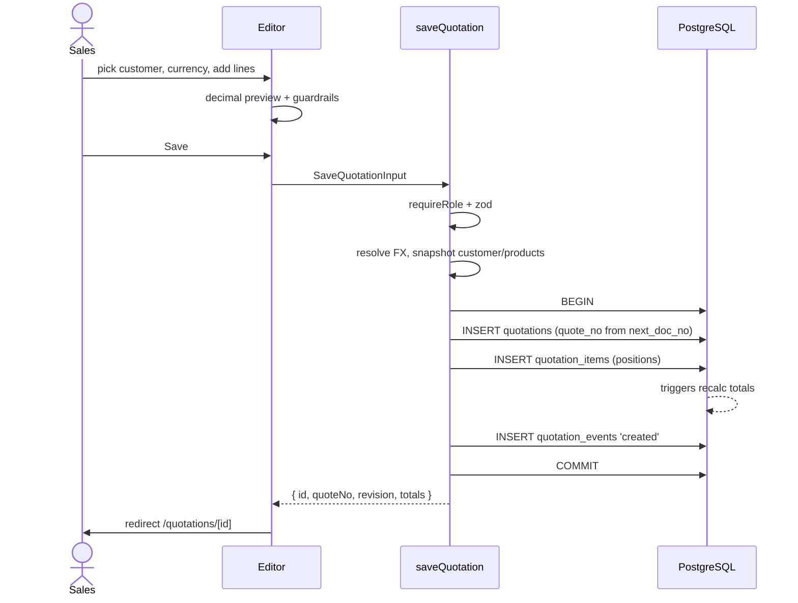
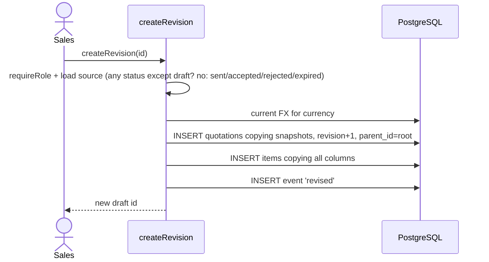
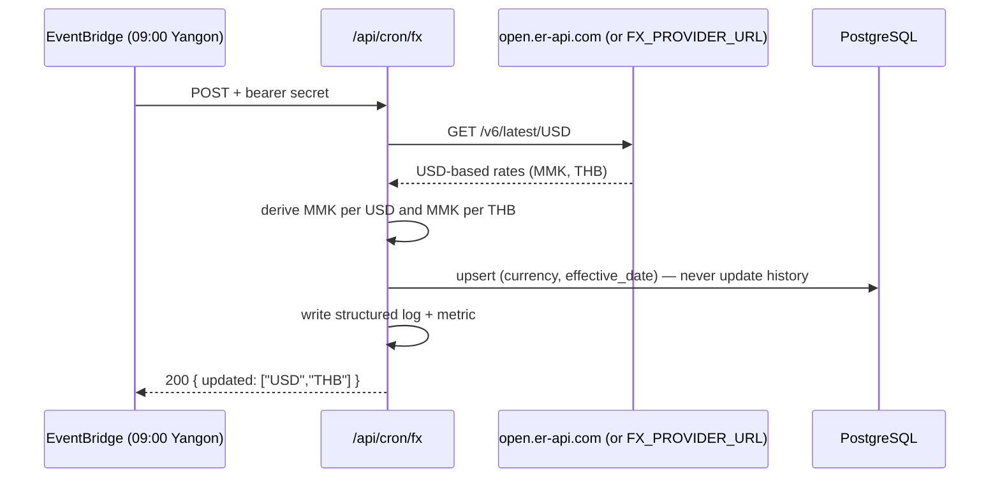

# 04 — Screens, Actions, and API Contracts

## 1. Screen map

| Route | Purpose | Roles |
|---|---|---|
| `/login` | Email + password | public |
| `/quotations` | List, search, filter by status/customer/owner/date | all |
| `/quotations/new` | Blank editor, optional `?customer=` / `?from=` | sales, admin |
| `/quotations/[id]` | Detail: totals, timeline, PDF, status actions | all |
| `/quotations/[id]/edit` | Editor (draft only) | sales, admin |
| `/customers` | Directory, create/edit drawer | sales, admin (viewer read) |
| `/products` | Catalog, prices per currency, cost/margin | sales, admin (viewer read) |
| `/reports` | Monthly sales, pipeline, win rate, product performance | all |
| `/settings` | Company profile, FX rates, users | admin (FX: sales can add manual rate) |

The quotation editor is a client component with a server-rendered shell: it holds
draft lines in local state, recalculates totals with `decimal.js` on every keystroke,
and submits the whole document to a server action. No autosave in MVP — an explicit
Save with an unsaved-changes guard is easier to reason about and cheaper to build.

## 2. Mutations (server actions)

All actions return a discriminated union so forms can show field-level errors:

```ts
type ActionResult<T> =
  | { ok: true; data: T }
  | { ok: false; error: { code: ErrorCode; message: string; fieldErrors?: Record<string, string[]> } };
```

| Action | Input | Rules |
|---|---|---|
| `saveQuotation` | full document (header + lines) | `requireRole('sales','admin')`; draft only; validates FX, customer, items; replaces lines in one transaction |
| `createRevision` | `quotationId` | copies header/items, `revision+1`, new FX rate, status `draft` |
| `updateStatus` | `quotationId`, `status`, `note?` | allowed transitions only; `sent` sets `sent_at`; `accepted`/`rejected` set timestamps |
| `deleteQuotation` | `quotationId` | admin only, `draft` only |
| `upsertCustomer` | customer fields | sales/admin |
| `deactivateCustomer` | id | admin; blocked if referenced by an active quote |
| `upsertProduct` | product + prices | sales/admin; SKU unique; MMK price required |
| `setProductActive` | id, active | admin |
| `upsertManualRate` | currency, rate, date, source | admin or sales; date ≥ today − 7 days |
| `uploadLogo` | presigned PUT (route handler) | admin only; PNG/SVG ≤ 1 MB |
| `updateCompanySettings` | settings | admin |
| `inviteUser` | email, name, role | admin; generates temp password, `must_change_password` |
| `resetUserPassword` | userId | admin; forces change on next login |
| `setUserActive` | userId, active | admin; cannot deactivate self |

Every action:

1. `const session = await requireSession()` then `requireRole(...)`.
2. Parse with a Zod schema shared with the form (`zodResolver`), including
   `.strict()` so unknown keys are rejected.
3. Run business checks (FX present, margin guardrail, status transition table).
4. Execute inside `db.transaction` when more than one statement is involved.
5. Write a `quotation_events` row for state changes.
6. `revalidatePath()` for affected routes and return fresh totals.

## 3. Read routes (route handlers)

| Route | Method | Notes |
|---|---|---|
| `/api/health` | GET | DB `select 1`, version, uptime; used by nginx and the deploy script |
| `/api/quotations/[id]/pdf` | GET | `?download=1` forces attachment; otherwise inline. Serves cached S3 object when fresh |
| `/api/quotations/[id]/csv` | GET | Line-item export for Excel reconciliation |
| `/api/cron/fx` | POST | `Authorization: Bearer $FX_CRON_SECRET`; pulls rates, upserts today's row |
| `/api/cron/expire` | POST | Same auth; marks overdue `sent` quotes expired |
| `/api/uploads/logo` | POST | Admin; validates MIME/size; returns S3 key |

PDF and CSV routes must re-check authorization themselves — route handlers are
outside the page-level layout guard.

## 4. Authorization matrix

| Capability | admin | sales | viewer |
|---|---|---|---|
| View quotes / PDF | ✅ | ✅ | ✅ |
| Create / edit draft quotes | ✅ | ✅ | — |
| Send / accept / reject | ✅ | ✅ | — |
| Delete draft | ✅ | — | — |
| See cost and margin | ✅ | ✅ | — |
| Discount > 15%, negative margin | ✅ | ❌ | — |
| Manage customers | ✅ | ✅ | — |
| Manage products/prices | ✅ | ✅ | — |
| Add manual FX rate | ✅ | ✅ | — |
| Reports | ✅ | ✅ | ✅ (values only) |
| Company settings, users | ✅ | — | — |

Enforcement is server-side in `requireRole()`; the UI hides controls but never relies
on that. `viewer` responses omit `cost_*` and `margin_mmk` from serialized payloads,
not just the UI.

## 5. Sum of flows

### Save a new quotation



### Revision



The original row is never modified; the revision chain is walkable via `parent_id`
and `(quote_no, revision)`.

### Status change

```
draft   → sent | cancelled
sent    → accepted | rejected | expired | draft (via revision, not direct)
accepted→ draft (via revision) | rejected (rare, admin)
expired → draft (via revision)
rejected→ draft (via revision)
```

`updateStatus` validates this table and rejects anything else with
`INVALID_TRANSITION`. Setting `accepted` requires the PDF to exist at least once
(the system generates it on demand if missing).

### FX sync



The default provider is the free, keyless open.er-api.com feed. Set
`FX_PROVIDER_URL` to override it; a provider may return the open feed shape or the
direct `{ rates: { USD: 4500, THB: 125 } }` MMK-per-unit shape. The admin Settings
page also has a **Refresh rates** button that runs the same sync immediately,
which is useful before the EventBridge schedule exists or after an FX jump.

If the provider fails, yesterday's rate stays usable and an alarm fires. A manual
rate added in Settings wins for that date (upsert on the same key, `source='manual'`
must not be overwritten by the cron — the cron skips dates that already have a
manual row).

## 6. Validation schemas (shape)

```ts
// Money and quantities arrive as decimal strings to avoid float drift.
const decimalString = (scale: number, max: string) =>
  z.string().trim()
    .regex(new RegExp(`^\\d{1,13}(\\.\\d{1,${scale}})?$`), 'Invalid number')
    .refine((v) => new Decimal(v).lte(max), 'Value too large');

const lineSchema = z.object({
  id: z.string().uuid().optional(),          // present when editing
  productId: z.string().uuid().nullable(),
  sku: z.string().trim().max(64).nullable(),
  name: z.string().trim().min(1).max(300),
  description: z.string().trim().max(2000).nullable(),
  unit: z.string().trim().max(20),
  quantity: decimalString(3, '1000000'),
  unitPrice: decimalString(4, '1000000000'),
  discountPct: z.coerce.number().min(0).max(100).default(0),
  taxRate: z.coerce.number().min(0).max(1),
  costUnitMmk: decimalString(2, '1000000000').default('0'),
});

const saveQuotationSchema = z.object({
  id: z.string().uuid().optional(),
  customerId: z.string().uuid(),
  projectTitle: z.string().trim().max(300).nullable(),
  subject: z.string().trim().max(300).nullable(),
  currency: z.enum(['MMK', 'USD', 'THB']),
  discountKind: z.enum(['none', 'percent', 'amount']),
  discountValue: decimalString(4, '1000000000').default('0'),
  defaultTaxRate: z.coerce.number().min(0).max(1),
  validUntil: z.string().date().nullable(),
  paymentTerms: z.string().max(4000).nullable(),
  // …
  items: z.array(lineSchema).min(1).max(100),
}).strict();
```

Money stays a string all the way to `decimal.js` on the server. Only counts
(`discountPct`, `taxRate`) are coerced to `number`.

## 7. Error model

| Code | HTTP | User-facing behaviour |
|---|---|---|
| `UNAUTHENTICATED` | 401 | Redirect to `/login` |
| `FORBIDDEN` | 403 | "You do not have permission for this action" |
| `VALIDATION` | 400 | Field errors inline |
| `NOT_FOUND` | 404 | Not-found page |
| `INVALID_TRANSITION` | 409 | Explain allowed next states |
| `FX_RATE_MISSING` | 422 | Link to Settings → Exchange rates |
| `GUARDRAIL_BLOCKED` | 422 | Show margin/discount reason and required role |
| `CONFLICT` | 409 | Quote changed since loaded — reload prompt |
| `PDF_FAILED` | 502 | Retry button, incident logged with quote id |
| `INTERNAL` | 500 | Generic message; correlation id in logs |

Never leak SQL errors, stack traces, or cost data in error messages.

## 8. Concurrency and consistency

- **Optimistic locking:** the editor submits `updatedAt`; the action updates
  `where id = $1 and updated_at = $2` and returns `CONFLICT` if zero rows. Internal
  tool, few editors, but this prevents silent overwrites.
- **Line replacement:** items are deleted and re-inserted inside the same transaction,
  preserving `position`. Generated columns and triggers make this safe.
- **Numbering:** atomic counter, no gaps guarantee needed (numbers may skip if a
  transaction rolls back; gaps are acceptable, duplicates are not).
- **PDF freshness:** cached when `pdf_generated_at >= updated_at`; saving invalidates
  by leaving the timestamp older.
- **Status vs PDF:** marking `sent` triggers PDF generation if no artifact exists.

## 9. Search, pagination, exports

- Quote list: keyset pagination on `(created_at desc, id desc)`, 25 per page.
- Filters: status, currency, customer, prepared_by, date range, free text on
  `quote_no`, `project_title`, customer name (`ILIKE '%term%'`, trigram index later).
- Default view: `draft` and `sent`, newest first; totals strip shows count and
  MMK pipeline value.
- CSV export mirrors the current filter (respecting role-based column hiding).
