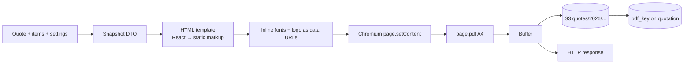

# 05 — PDF Generation and Branding

## 1. Why Chromium

The quotation PDF is the customer-facing artifact; it must render Burmese and English
correctly. Most Node PDF libraries (`@react-pdf/renderer`, `pdfkit`) do not perform
full complex-script shaping. Burmese needs reordering and context-sensitive glyph
substitution (ြ, ွ, ှ, ်, ု, ူ, ဲ, ံ, ့, kinzi), which those libraries get wrong or
ignore.

Chromium renders exactly what the browser renders, including variable fonts, CSS
grid, page headers/footers, and Unicode shaping. Since the app already runs on EC2,
the cost is one container layer, not a vendor contract.

Rejected alternatives:

| Option | Why not |
|---|---|
| `@react-pdf/renderer` | Weak shaping, custom layout language, fontkit limitations |
| wkhtmltopdf | Unmaintained, old WebKit, poor Unicode |
| ReportLab / Puppeteer alternatives | More code, same Chromium requirement |
| DocRaptor / PDFShift | Per-document cost, customer data leaves the VPC |

## 2. Pipeline



Render route: `GET /api/quotations/[id]/pdf`

> **MVP implementation note (current repo):** PDFs are rendered on demand and
> streamed with `Cache-Control: private, no-store`. There is no S3 upload and no
> `pdf_key`; every request re-renders from the frozen quote snapshot. The
> `quotation_events` `pdf_generated` log entry is also deferred. The S3 cache
> below is the planned Phase 4 optimisation, not current behaviour.

1. Authenticate and authorize (`viewer` allowed).
2. Load quote, items, company settings, logo.
3. If `pdf_generated_at >= updated_at` and `pdf_key` exists → presigned redirect.
4. Otherwise render, upload to S3, update `pdf_key`/`pdf_generated_at`, stream response.
5. Log `pdf_generated` (duration, bytes, template version) to `quotation_events` and
   structured logs.

`?download=1` sets `Content-Disposition: attachment`; default is inline preview.
Until the dedicated preview screen exists, the detail page's **Preview PDF**
button opens this route in a new tab; the same HTML/CSS is used for both preview
and download.

> **Font test page:** bundled fonts live in `public/fonts` and are validated via
> the quote PDF (Noto Sans Myanmar + Padauk embedded, Latin text in Inter). A
> `/dev/fonts` page is optional and not shipped.

## 3. Fonts (critical)

Bundle fonts in the image, do not fetch from Google Fonts at runtime:

| Font | Use | Licence |
|---|---|---|
| **Noto Sans Myanmar** | Primary Burmese | OFL |
| **Padauk** | Fallback Burmese | OFL |
| **Inter** | Latin body and numbers | OFL |

Rules:

- Reference fonts as base64 `@font-face` inside the HTML. No network requests during
  render, no `file://` permission issues, deterministic output.
- `font-display: block` and `await document.fonts.ready` before `page.pdf()`.
- Font stack: `'Inter', 'Noto Sans Myanmar', 'Padauk', sans-serif`.
- Never apply `text-transform: uppercase` or `letter-spacing` to Burmese text — both
  break clusters.
- Line height 1.7 for Burmese paragraphs; 1.4 for Latin-only tables.
- Reject Zawgyi: run a heuristic check on customer/product/notes text at save time and
  show "This looks like Zawgyi. Please convert to Unicode."

Add a font test page (`/dev/fonts`, admin-only, non-production) containing:

```
မြန်မာ ကျွန်ုပ်တို့ ကုမ္ပဏီ လိပ်စာ ၁၂၃
ကွန်ရက် လုံခြုံရေး စနစ် တပ်ဆင်ခြင်း
```

and verify kinzi, stacked vowels, and `ြ`/`ွ` ordering visually before sign-off.

## 4. Template structure

```
┌──────────────────────────────────────────────┐
│ [logo]  VITALTECH MYANMAR        QUOTATION   │  header
│         System Integration        VT-Q-…     │
│                                              │
│ To: Customer            Date / Valid until   │  meta grid
│ Attention / Address     Currency / FX note   │
│                                              │
│ Project: …                                   │  title block
│                                              │
│ #  Description            Qty  Unit  Price  Amount │  items
│ ──────────────────────────────────────────── │
│                                              │
│                          Subtotal  1,409.50  │  totals
│                          Discount   −28.19   │
│                          Tax 5%      69.07   │
│                          TOTAL     1,450.38  │
│                                              │
│ Amount in words: …                           │
│                                              │
│ Payment terms / Delivery / Warranty          │  terms
│ Exclusions / Notes                           │
│                                              │
│ [signature]              [company stamp]     │  sign-off
│ Prepared by …                                │
└──────────────────────────────────────────────┘
```

Components: `QuoteHeader`, `CustomerBlock`, `ItemsTable`, `TotalsBlock`,
`AmountInWords`, `TermsSection`, `SignatureBlock`, `PageFooter`.

Design details:

- A4, 14 mm side margins, 20 mm top / 22 mm bottom (space for header/footer).
- Brand colour from `company_settings` (logo + one accent), not hard-coded.
- Items table repeats its header on each page (`thead { display: table-header-group }`).
- `tr { break-inside: avoid }`; terms blocks use `break-inside: avoid` where sensible.
- Draft watermark: rotated, 8% opacity, `print-color-adjust: exact`.
- Expired notice: red band under the meta grid.
- Footer: `VitalTech Myanmar · page X of Y · generated 28 Oct 2026`.
- Amount in words in English (MMK/USD/THB) with the currency named; Burmese optional later.

## 5. Renderer implementation sketch

```ts
// src/lib/pdf/render.ts
import { chromium, type Browser } from 'playwright-core';

const MAX_RENDERS_PER_BROWSER = 200;
const MAX_CONCURRENCY = 2;

let browser: Browser | null = null;
let renderCount = 0;
let active = 0;
const queue: Array<() => void> = [];

async function acquire() {
  if (active >= MAX_CONCURRENCY) await new Promise<void>((r) => queue.push(r));
  active++;
}
function release() {
  active--;
  queue.shift()?.();
}

async function getBrowser() {
  if (browser?.isConnected() && renderCount < MAX_RENDERS_PER_BROWSER) return browser;
  await browser?.close().catch(() => {});
  browser = await chromium.launch({
    args: ['--no-sandbox', '--disable-dev-shm-usage', '--disable-gpu'],
  });
  renderCount = 0;
  return browser;
}

export async function renderQuotationPdf(html: string): Promise<Buffer> {
  await acquire();
  const b = await getBrowser();
  const context = await b.newContext();          // JS stays enabled: fonts.ready needs it
  const page = await context.newPage();
  try {
    await page.setContent(html, { waitUntil: 'load', timeout: 15_000 });
    await page.evaluate(async () => { await document.fonts.ready; });
    const pdf = await page.pdf({
      format: 'A4',
      printBackground: true,
      margin: { top: '20mm', bottom: '22mm', left: '14mm', right: '14mm' },
      displayHeaderFooter: true,
      headerTemplate: '<div></div>',
      footerTemplate: footerTemplate(), // inline styles only
    });
    renderCount++;
    return Buffer.from(pdf);
  } finally {
    await context.close();
    release();
  }
}
```

Gotchas:

- `displayHeaderFooter` needs margins in the `pdf()` options; do **not** also set
  `@page { margin: … }` — the two fight and content shifts. Set `@page { size: A4 }`
  only, or omit `@page` entirely and rely on `format: 'A4'`.
- Header/footer templates render in a separate document: they cannot use app CSS or
  webfonts. Use inline styles, system font, 8 px.
- A render timeout of 15 s and a hard 30 s ceiling protects the Node process.
- If `page.pdf()` fails, close the whole browser on the next call (handled by the
  `isConnected` check) and log the quote id.

## 6. Caching and invalidation

| Event | Effect |
|---|---|
| Quote saved | `updated_at` moves ahead of `pdf_generated_at` → next request re-renders |
| Status change | same, plus header/watermark changes |
| Settings changed | bump `settings_version`; include it in the cache check |
| Template changed | deploy `TEMPLATE_VERSION`; key includes `t{version}` |
| Revision created | new row, new key (`-r2-…`) |

S3 key: `quotes/{year}/{quote_no}-r{revision}-t{templateVersion}.pdf`.
Objects are immutable; regeneration writes a new key. Lifecycle: standard → Intelligent
Tiering after 90 days. Bucket versioning on, public access blocked, SSE-S3 or SSE-KMS.

## 7. Performance

- Cold browser launch ~1.5–2.5 s; warm renders ~0.8–1.5 s for a 2-page quote.
- Concurrency 2 on a 2 GB instance; queue beyond that instead of spawning browsers.
- Recycle the browser every 200 renders to bound memory growth.
- Logo and fonts are read once into module memory; never per request from S3.
- Keep the PDF HTML free of application JavaScript; the only script execution is the
  `document.fonts.ready` await inside the renderer.

## 8. Testing

1. **Unit** — `buildQuotePdfDto()`: totals, FX lines, amount in words, snapshot fields.
2. **Render smoke** — Playwright test loads `/quotations/[id]/preview`, asserts no
   overflow, screenshot diff against baseline (tolerance 0.1%).
3. **PDF text extraction** — `pdftotext` in CI; assert quote number, customer name,
   total, and Burmese sample string are present.
4. **Visual checklist** — manual sign-off on: 1-page, 3-page with repeated table header,
   long Burmese description, mixed currency note, draft watermark, expired notice,
   zero-discount variant.
5. **Failure path** — simulate Chromium crash; assert API returns `PDF_FAILED` with a
   correlation id and no partial S3 object.

## 9. Accessibility and metadata (optional, cheap)

- `<title>` = quote number + customer, appears in the PDF properties.
- Chromium `tagged: true` for a tagged PDF (better for screen readers, larger file).
- Keep body text ≥ 9 pt; financial tables ≥ 8.5 pt.
- Colour contrast for the accent colour: enforce ≥ 4.5:1 in settings validation.
