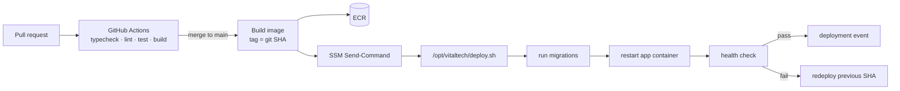

# 06 — Security, AWS Operations, and Runbooks

## 1. Network layout and security groups

```
Internet ──80/443──► nginx (EC2, public subnet) ──3000──► app container ──5432──► RDS (private)
                            │
                            ├──443──► S3 (gateway endpoint)
                            ├──443──► ECR / Secrets Manager / CloudWatch
                            └──443──► FX provider
```

| Security group | Inbound | Outbound |
|---|---|---|
| `sg-edge` | 443 from office egress IPs (and 0.0.0.0/0 if staff work remotely); 80 from 0.0.0.0/0 for ACME + redirect | 3000 to `sg-app` (Docker network, no SG needed if both are the same instance) |
| `sg-app` | 3000 from `sg-edge`; 22 **disabled** | 5432 to `sg-rds`; 443 to 0.0.0.0/0 (FX, ECR, S3); 53 DNS |
| `sg-rds` | 5432 from `sg-app` only | none |

Because nginx and the app run on the same EC2 host, `sg-edge` and `sg-app` collapse
into one instance security group with 80/443 open. Keep the logical split documented
so an ALB can be added without rethinking the rules.

- No SSH. Use **SSM Session Manager** (requires the SSM agent and outbound 443, or VPC
  interface endpoints).
- RDS: `Publicly accessible = No`, encryption at rest on, `rds.force_ssl = 1`
  (the app connects with `sslmode=require`).
- If an ALB is added for HA, it terminates TLS with ACM and talks HTTP to nginx on
  port 80; nginx drops the 301 redirect and trusts `X-Forwarded-For` from the ALB
  subnet (commented block in `deploy/nginx/qgs.conf`).
- Optional AWS WAF managed rules on the ALB; on the nginx-only path, nginx enforces
  the login rate limit and security headers.

## 2. Identity and access

**EC2 instance role** (`qgs-ec2-role`):

- `s3:GetObject`, `s3:PutObject`, `s3:DeleteObject` on `arn:aws:s3:::vitaltech-qgs-prod/*` only
- `logs:CreateLogGroup`, `logs:CreateLogStream`, `logs:PutLogEvents` on `/qgs/*`
- `secretsmanager:GetSecretValue` on the one QGS secret
- `ssm:*` core permissions for Session Manager
- No `s3:*`, no wildcard resources, no static access keys anywhere.

**GitHub Actions role** (OIDC, no stored keys):

- Trust policy restricted to `repo:vitaltech/qgs:ref:refs/heads/main`
- `ecr:GetAuthorizationToken`, push/pull on the QGS repository
- `ssm:SendCommand` on the QGS instance and `ssm:GetCommandInvocation`

**Human access**: IAM Identity Center (or IAM users with MFA) for the console; read-only
for most staff, admin for the two maintainers. DB access only through SSM port
forwarding, using a personal read-only DB account for investigations.

## 3. Secrets

| Secret | Where | Rotation |
|---|---|---|
| `DATABASE_URL` | Secrets Manager (`qgs/prod/db`) | 90 days, coordinated |
| `AUTH_SECRET` | Secrets Manager | 180 days; invalidates sessions |
| `FX_CRON_SECRET` | Secrets Manager | 180 days |
| `FX_API_KEY` | Secrets Manager (optional) | per provider |
| AWS credentials | none — instance role | n/a |

Loaded once at boot in `src/instrumentation.ts` (`register()`), merged into
`process.env` before the first request. Never baked into the image, never sent to the
browser, redacted from logs. `.env.example` documents names only.

`AUTH_SECRET` rotation logs everyone out; do it outside business hours.

## 4. Application security

| Control | Implementation |
|---|---|
| Password storage | Argon2id (`@node-rs/argon2`), memory 64 MB, iterations 3, parallelism 1 |
| Session | Auth.js JWT, `httpOnly`, `secure`, `sameSite=lax`, 8 h max age, rolling |
| Login throttling | 5 failures per email+IP / 15 min, then 15 min lockout; generic error text |
| CSRF | Auth.js origin check + server actions (POST-only, origin validated) |
| Headers | HSTS, `X-Content-Type-Options`, `Referrer-Policy`, `X-Frame-Options: DENY`, CSP with script nonce |
| SQL injection | Drizzle parameterized queries only; no string-built SQL |
| XSS | React escaping; notes rendered as text with `white-space: pre-wrap`; no `dangerouslySetInnerHTML` except the generated PDF HTML (server-side, escaped) |
| File upload | Logo only, admin, MIME sniff + 1 MB cap, re-encoded to PNG, private bucket |
| Authorization | `requireRole()` in every action and route handler; viewer payloads strip cost/margin |
| Audit | `quotation_events` + structured logs with user id, action, quote id, IP |
| Dependencies | `pnpm audit` + Dependabot in CI; image rebuilt weekly |
| DB privileges | App user: DML only. Migrations use a separate DDL user. No superuser |

> **Current CSP implementation:** `src/middleware.ts` adds a fresh nonce to the
> `Content-Security-Policy` on every request and forwards it to the app via a
> request header so Next.js stamps its scripts. Middleware deliberately performs
> **no authorization** — it only sets headers. All authn/authz runs in server
> components and server actions (`requireSession` / `requireRole`), so a
> middleware matcher mistake cannot expose data. `upgrade-insecure-requests` is
> emitted only when `APP_URL`/`AUTH_URL` is HTTPS, which keeps plain-HTTP
> development and pre-certificate smoke tests usable.

## 5. Deploy pipeline



`deploy/deploy.sh` (stored on the instance, versioned in this repo, invoked with the
image URI):

```bash
IMAGE="$1"                          # <registry>/vitaltech-qgs:<sha>
MIGRATE_IMAGE="${IMAGE}-migrate"    # published by CI alongside the app image
export QGS_IMAGE="$IMAGE" QGS_MIGRATE_IMAGE="$MIGRATE_IMAGE"

docker compose -f docker-compose.prod.yml pull app migrate
docker compose -f docker-compose.prod.yml run --rm --no-deps migrate
docker compose -f docker-compose.prod.yml up -d --no-deps app nginx
curl -fsS --retry 20 --retry-delay 3 http://127.0.0.1:3000/api/health
docker compose -f docker-compose.prod.yml exec -T nginx nginx -t
docker compose -f docker-compose.prod.yml exec -T nginx nginx -s reload
```

The real script also logs in to ECR, records the current image for rollback, and
redeploys the previous tag if the health check does not pass.

Notes:

- Migrations run **before** the new app starts and must be backward compatible with the
  previous release (expand → migrate → contract across two deploys).
- The health endpoint checks DB connectivity, schema version, and disk space.
- Deployments are serialized with a lock file / SSM concurrency limit 1.
- Image tags are immutable; `latest` is never deployed.

## 6. TLS certificates

nginx is the only public listener:

- **:80** — ACME challenge under `/.well-known/acme-challenge/`, a `/nginx-health`
  endpoint for container health checks, and a 301 to HTTPS.
- **:443** — TLS 1.2/1.3, HTTP/2, HSTS and security headers, per-IP login throttling,
  120 s proxy timeouts for PDF generation.

Certbot runs on the **host**, not in a container, so certificates and the renewal
timer survive container restarts and compose changes.

One-time bootstrap:

```bash
sudo apt-get install -y certbot
sudo mkdir -p /var/www/certbot

# port 80 is still free at this point
sudo certbot certonly --standalone -d vitaltechmyanmar.com \
  --email ops@vitaltechmyanmar.com --agree-tos --no-eff-email

# nginx mounts /etc/letsencrypt (ro) and /var/www/certbot (ro)
cd /opt/vitaltech && docker compose up -d
```

Renewal — `/etc/cron.d/qgs-certbot` (or a systemd timer):

```cron
0 3 * * * root certbot renew --quiet --webroot -w /var/www/certbot \
  --deploy-hook "docker compose -f /opt/vitaltech/docker-compose.prod.yml exec -T nginx nginx -s reload"
```

Operational notes:

- `APP_URL` and `AUTH_URL` must be the `https://` origin; session cookies are `Secure`.
- After editing `deploy/nginx/qgs.conf`:
  `docker compose exec nginx nginx -t && docker compose exec nginx nginx -s reload`.
  `deploy.sh` does this automatically on every release.
- nginx resolves the `app` upstream at start/reload. Every deploy recreates the app
  container with a new IP, which is why `deploy.sh` reloads nginx after the health
  check passes.
- Moving to ALB + ACM later: keep only the `:80` server, drop the redirect, trust
  `X-Forwarded-For` from the ALB subnet, and drop `:443` from the security group.

## 7. Database operations

- **Sizing:** `db.t4g.micro` staging, `db.t4g.small` production, 20–50 GB gp3,
  Multi-AZ in production.
- **Connections:** `pg.Pool` max 10 per app instance; RDS Proxy not needed at this scale.
- **Parameters:** `timezone = Asia/Yangon` (for `now()` display), `log_min_duration_statement = 500`,
  `idle_in_transaction_session_timeout = 30s`, `statement_timeout = 15s` for the app user.
- **Backups:** automated daily, retention 14 days, PITR enabled. Manual snapshot before
  every schema change. Monthly `pg_dump` to S3 for portability.
- **Restore drill:** quarterly — restore the latest snapshot to a scratch instance,
  run `select count(*)` checks, drop it. Record the result.
- **Migrations:** forward-only SQL, reviewed in PR, applied by the deploy job. A failed
  migration aborts the deploy; the app stays on the previous version.

## 8. Monitoring and alerts

| Alarm | Threshold | Action |
|---|---|---|
| nginx 5xx rate | > 1% for 5 min | Page maintainer |
| Upstream response p95 | > 2 s for 10 min | Investigate DB/PDF load |
| EC2 CPU | > 80% for 10 min | Check Chromium concurrency |
| EC2 memory available | < 250 MB for 5 min | Restart app, review PDF load |
| EC2 disk | < 15% free | Prune images/logs |
| RDS CPU | > 80% for 10 min | Slow-query review |
| RDS free storage | < 5 GB | Grow storage |
| RDS connections | > 80% of max | Pool review |
| Backup failure | any | Page maintainer |
| Log filter `level=error` | > 10/min | Investigate |
| FX cron non-200 | 2 consecutive days | Manual rate fallback |
| Certificate expiry | < 21 days | `certbot renew` + nginx reload |

Logs: JSON (pino) to stdout → `awslogs` driver → CloudWatch, 30-day retention.
Include `requestId`, `userId`, `route`, `durationMs`, `quoteId` where relevant. Never
log passwords, tokens, full customer contact blocks, or PDF contents.

Sentry (or CloudWatch RUM) is optional; if added, scrub PII and disable request bodies.

## 9. Cost estimate (ap-southeast-1, on-demand, monthly)

| Item | Spec | Approx. |
|---|---|---|
| EC2 | t4g.small, 30 GB gp3 | $15 |
| nginx + certbot | host packages, same instance | $0 |
| RDS | db.t4g.small, Multi-AZ, 50 GB | $55–65 |
| S3 | < 5 GB + requests | $1 |
| Secrets Manager | 4 secrets | $2 |
| CloudWatch | logs + alarms | $3–5 |
| Route 53 | hosted zone | $0.50 |
| **Total** | | **~$75–90** |
| *Optional* ALB + ACM | HA upgrade | +$18–22 |

Single-AZ RDS without the optional ALB brings this to roughly **$45–55**.
These are estimates; confirm with the AWS pricing calculator before purchase.

## 10. Runbooks

**App down**

1. `curl -fsS https://vitaltechmyanmar.com/api/health`; if it fails, SSM into the
   instance and check `docker compose ps`.
2. `docker compose logs --tail=200 app` and `... nginx`.
3. Check disk (`df -h`) and memory (`free -m`); Chromium OOM is the usual cause.
4. Restart: `docker compose restart app`; if the image is bad, redeploy the previous
   SHA with `deploy.sh`.

**502 from nginx after a deploy**

The app container was recreated with a new IP and nginx still points at the old one.

1. `docker compose exec nginx nginx -t`.
2. `docker compose exec nginx nginx -s reload`.
3. If it persists, `docker compose restart nginx` and check `app` is healthy on
   `127.0.0.1:3000/api/health`.

**Database restore**

1. Identify the point in time (use `quotation_events` timestamps).
2. Restore to a new instance (`aws rds restore-db-instance-to-point-in-time`).
3. Validate row counts and the most recent quotes.
4. Repoint `DATABASE_URL` in Secrets Manager, restart the app, keep the old instance
   until sign-off.

**Rotate `AUTH_SECRET`**

1. Generate a new value, update Secrets Manager.
2. Restart the app (all users are logged out).
3. Announce in advance; avoid month-end.

**FX provider outage**

1. Alarm fires; check the provider status.
2. Add a manual rate in Settings → Exchange rates (sales or admin).
3. The cron skips dates with a manual rate; no action needed when the provider returns.

**Chromium failures**

1. Check logs for `PDF_FAILED` and `Target closed`.
2. Restart the container (recycles the browser).
3. If persistent, lower `MAX_CONCURRENCY` to 1 and check available memory.

**Certificate renewal**

1. `sudo certbot renew --dry-run` — confirms the webroot path and DNS.
2. Check that port 80 is reachable from the internet and that nginx serves
   `/.well-known/acme-challenge/`.
3. If renewal succeeds but browsers show the old cert, reload nginx:
   `docker compose exec nginx nginx -s reload`.
4. Force a new certificate only if necessary:
   `certbot certonly --webroot -w /var/www/certbot -d vitaltechmyanmar.com --force-renewal`.

## 11. Hardening checklist before go-live

- [ ] No public sign-up route; `/login` only; admin-created accounts
- [ ] All routes except `/login` and `/api/health` require a session
- [ ] Viewer responses contain no cost or margin fields
- [ ] RDS not publicly accessible; `sg-rds` allows only `sg-app`
- [ ] TLS enforced; HTTP redirects; HSTS on
- [ ] Secrets only from Secrets Manager; image scanned for leaked env files
- [ ] `nginx -t` passes; HTTP redirects to HTTPS; TLS 1.2+ only
- [ ] `certbot renew --dry-run` succeeds; renewal timer is enabled
- [ ] Login rate limit verified (rapid attempts return 429)
- [ ] Backups enabled and one restore tested
- [ ] Alarms routed to a monitored channel, not just email
- [ ] Login throttling verified
- [ ] Zawgyi detection verified with real customer names
- [ ] PDF verified for Burmese shaping, 1-page and 3-page quotes
- [ ] Audit trail shows create, send, accept, revision, PDF generation
- [ ] Data export (CSV) works for finance reconciliation
